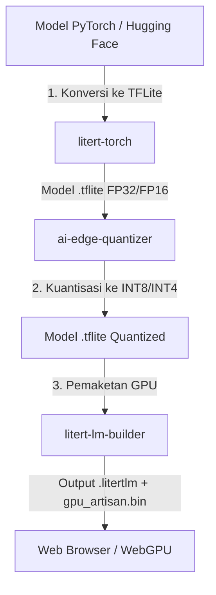

# Panduan Lengkap Konversi dan Pemaketan Model untuk WebGPU (LiteRT-LM)

Panduan ini menjelaskan alur kerja lengkap (*end-to-end pipeline*) untuk mengonversi model AI (seperti dari PyTorch/Hugging Face), melakukan kuantisasi, hingga memaketkannya menjadi format `.litertlm` yang sepenuhnya kompatibel dengan **WebGPU** (menyertakan berkas GPU kernel `gpu_artisan.bin`).

---

## Alur Kerja Konversi & Pemaketan



---

## Langkah 1: Persiapan Environment
Siapkan virtual environment Python dan pasang semua pustaka yang dibutuhkan:

```bash
# Membuat & mengaktifkan virtual environment
python3 -m venv .venv
source .venv/bin/activate

# Menginstal SDK AI-Edge Google & dependensi PyTorch
pip install litert-torch litert-lm-builder ai-edge-quantizer torch torchvision
```

---

## Langkah 2: Mengonversi Model PyTorch ke LiteRT (TFLite)
Gunakan `litert-torch` untuk mengonversi arsitektur model dari PyTorch. 

Sebagai contoh, jika Anda menggunakan model berbasis Transformer (LLM), jalankan skrip konversi PyTorch Generative API:

```python
import torch
import litert_torch as ltt
from transformers import AutoModelForCausalLM, AutoTokenizer

# 1. Muat model dari Hugging Face
model_id = "Qwen/Qwen2.5-1.5B-Instruct"
model = AutoModelForCausalLM.from_pretrained(model_id, torch_dtype=torch.float32)
tokenizer = AutoTokenizer.from_pretrained(model_id)

# 2. Lakukan konversi ke format LiteRT (.tflite)
# API ini secara otomatis mengonversi grafik model dan mengoptimalkan KV-cache
tflite_model_path = "models/qwen2_5_1_5b.tflite"
ltt.convert(model, tflite_model_path)

# Simpan juga file kosakata tokenizer (SentencePiece/BPE)
tokenizer.save_pretrained("models/tokenizer_dir")
```

---

## Langkah 3: Melakukan Kuantisasi (Sangat Penting untuk WebGPU)
Model dalam format FP32/FP16 terlalu berat untuk diunduh dan dijalankan di browser. Gunakan `ai-edge-quantizer` untuk mengompresi model menjadi 8-bit (INT8) atau 4-bit (INT4).

Jalankan perintah kuantisasi berikut:

```bash
# Mengompresi model ke bobot INT8 (rekomendasi untuk keseimbangan performa & akurasi)
python3 -m ai_edge_quantizer.quantize \
  --input_tflite_model=models/qwen2_5_1_5b.tflite \
  --output_tflite_model=models/qwen2_5_1_5b_int8.tflite \
  --quantization_mode=WEIGHTS_ONLY_INT8
```

---

## Langkah 4: Memaketkan Ulang ke Format `.litertlm` dengan Target GPU
Sekarang, gabungkan berkas `.tflite` hasil kuantisasi dengan tokenizer Anda menjadi kontainer tunggal `.litertlm` yang mendukung WebGPU.

### Metode A: Menggunakan CLI (Praktis)
Tambahkan opsi parameter `--backend_constraint=gpu` agar compiler menghasilkan berkas grafik shader GPU (`gpu_artisan.bin`):

```bash
litert-lm-builder \
  --model_path=models/qwen2_5_1_5b_int8.tflite \
  --tokenizer_path=models/tokenizer_dir/tokenizer.model \
  --backend_constraint=gpu \
  --output_path=models/qwen2_5_1_5b_gpu.litertlm
```

---

### Metode B: Menggunakan File Konfigurasi TOML
Metode ini sangat disarankan untuk menjaga reproduksi konfigurasi proyek:

1. Buat berkas `model_config.toml`:
   ```toml
   [model]
   model_path = "models/qwen2_5_1_5b_int8.tflite"
   tokenizer_path = "models/tokenizer_dir/tokenizer.model"
   
   [backend]
   # Mengarahkan target backend ke GPU (WebGPU/Metal)
   target = "gpu"
   
   [metadata]
   name = "Qwen 2.5 1.5B GPU Web"
   version = "1.0"
   description = "Model teroptimasi GPU untuk penggunaan web browser (WebGPU)."
   ```

2. Bangun kontainer `.litertlm` menggunakan TOML:
   ```bash
   litert-lm-builder toml --path model_config.toml output --path models/qwen2_5_1_5b_gpu.litertlm
   ```

---

## Langkah 5: Memverifikasi Hasil Pemaketan
Gunakan perintah `litert-lm-peek` untuk memeriksa apakah berkas `gpu_artisan.bin` telah masuk ke dalam kontainer `.litertlm`:

```bash
litert-lm-peek --path models/qwen2_5_1_5b_gpu.litertlm
```

**Output validasi yang harus terlihat:**
```text
Archive: models/qwen2_5_1_5b_gpu.litertlm
├── model.tflite (Model weights & graph)
├── tokenizer.model (Model vocabulary)
└── gpu_artisan.bin (Wajib ada - berkas kernel khusus WebGPU/GPU)
```

Jika ketiga komponen di atas sudah terdaftar, model Anda sekarang siap diunggah ke aplikasi web dan dijalankan menggunakan akselerasi **WebGPU** browser tanpa hambatan.
