# 🤖 EduVis AI Gallery & Gemma 4 Local AI Suite

**EduVis AI Gallery** adalah rangkaian aplikasi AI lokal (*on-device*) berbasis **Gemma 4** dan **LiteRT-LM** yang berjalan sepenuhnya di perangkat Anda tanpa kunci API berbayar maupun ketergantungan cloud. Proyek ini menggabungkan **antarmuka web client-side (WebGPU/WASM)**, **server LAN HTTPS**, **percakapan suara interaktif (EduVis Live & Futuristik)**, **TTS Neural lokal**, serta **aplikasi native macOS SwiftUI**.

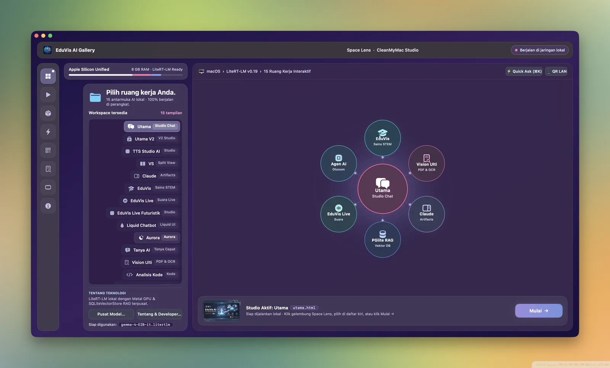

---

## 📑 Daftar Isi
- [Galeri Tangkapan Layar](#-galeri-tangkapan-layar)
- [Fitur Utama & Ruang Kerja](#-fitur-utama--ruang-kerja)
- [Arsitektur Sistem & Alur Lengkap](#️-arsitektur-sistem--alur-lengkap)
- [Alur Mode EduVis Live & EduVis Live Futuristik](#️-alur-mode-eduvis-live--eduvis-live-futuristik)
- [Dukungan Model LLM & Spesifikasi Perangkat](#-dukungan-model-llm--spesifikasi-perangkat)
- [Instalasi & Unduh Model Mandiri](#-instalasi--unduh-model-mandiri)
- [Cara Menjalankan Aplikasi](#-cara-menjalankan-aplikasi)
- [Panduan Build Aplikasi macOS (Gallery, Native, & DMG)](#-panduan-build-aplikasi-macos-eduvis-ai-gallery--eduvis-native-ai)
- [Akses Multi-Perangkat di LAN HTTPS & QR Code](#-akses-multi-perangkat-di-lan-https--qr-code)
- [Ekspor Visualisasi & Uji Regresi](#-ekspor-visualisasi--uji-regresi)
- [Struktur File Utama](#-struktur-file-utama)
- [Troubleshooting & FAQ](#️-troubleshooting--faq)
- [Kredit & Atribusi Open-Source](#-kredit--atribusi-open-source)

---

## 📸 Galeri Tangkapan Layar

### EduVis AI Gallery (Launcher, Visualisasi, TTS Studio, & Mode Live)

| EduVis AI Gallery — Space Lens Launcher | Workspace Utama — Flowchart Mermaid & RAG |
| :---: | :---: |
|  | 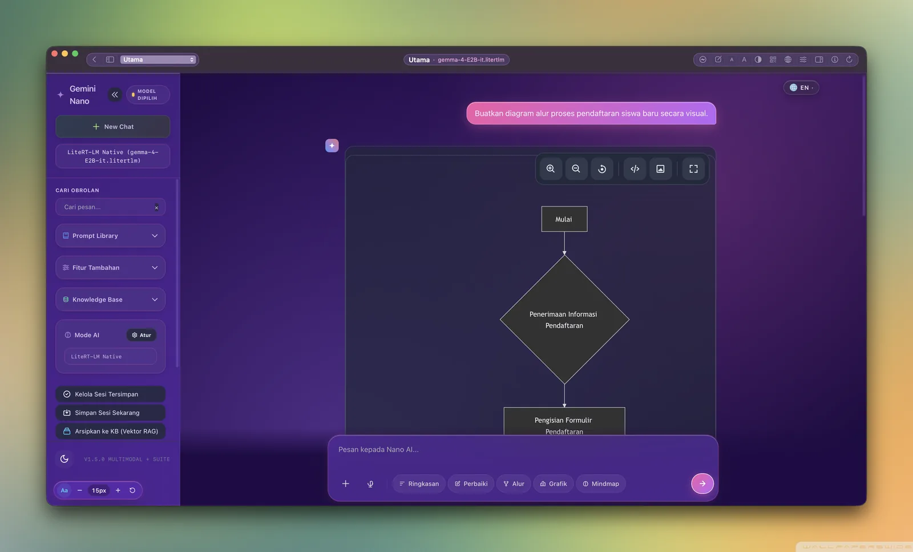 |

| TTS Studio AI — Narasi 100% Offline | EduVis Live — Auto VAD & Siri Live Sphere |
| :---: | :---: |
| 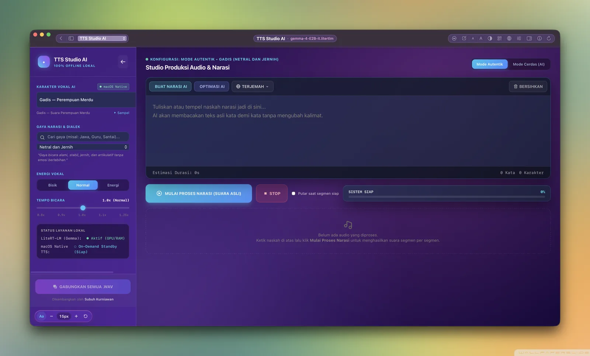 | 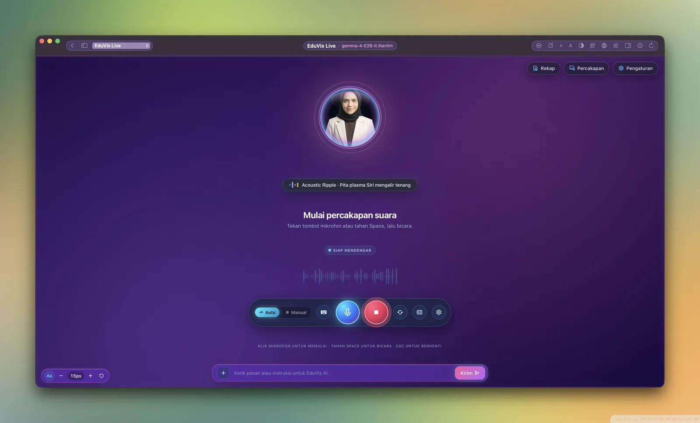 |

| EduVis Live Futuristik — Suara Duplex GPU | |
| :---: | :---: |
| 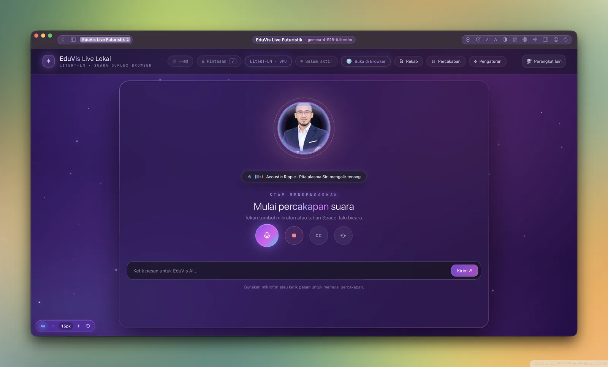 | **Mode Suara Real-Time:** Mendukung Auto VAD, Push-to-Talk, TTS lokal on-demand (VITS/Piper/RVC), fallback Realtime Native, avatar **Siri Live Sphere**, dan akses lintas perangkat via QR LAN. |

### EduVis Native AI (Aplikasi macOS 100% SwiftUI Liquid Glass)

| EduVis Native AI Studio | Obrolan Gemma 4 Lokal & Render Markdown |
| :---: | :---: |
| 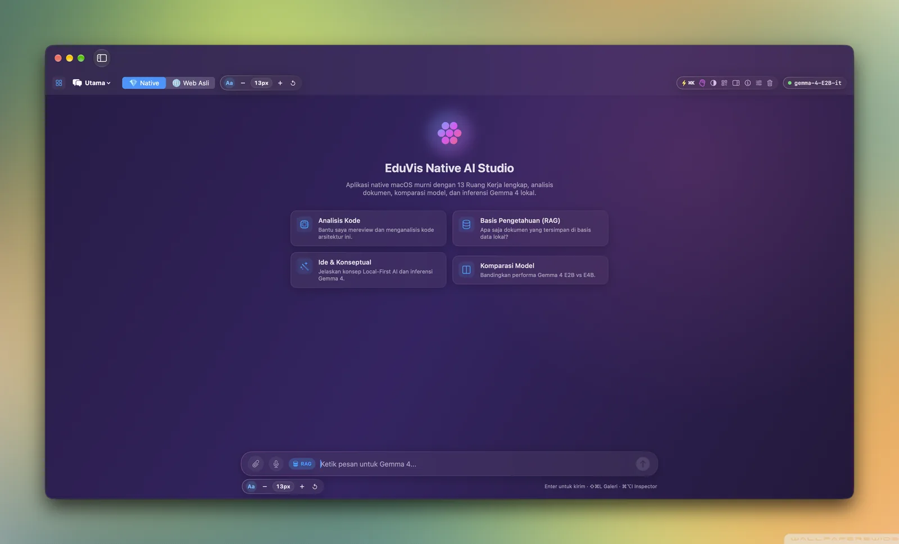 | 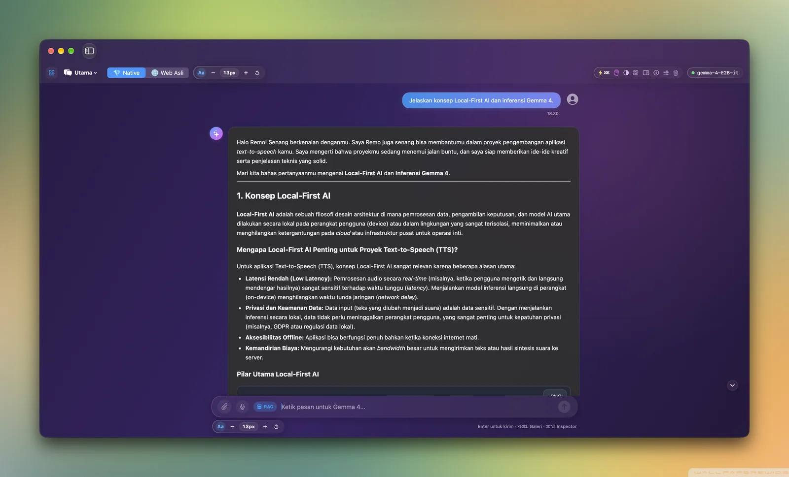 |

| Peluncur 13 Ruang Kerja Hybrid (Native & Web Asli) | Tentang Aplikasi, Arsitektur, & Developer |
| :---: | :---: |
| 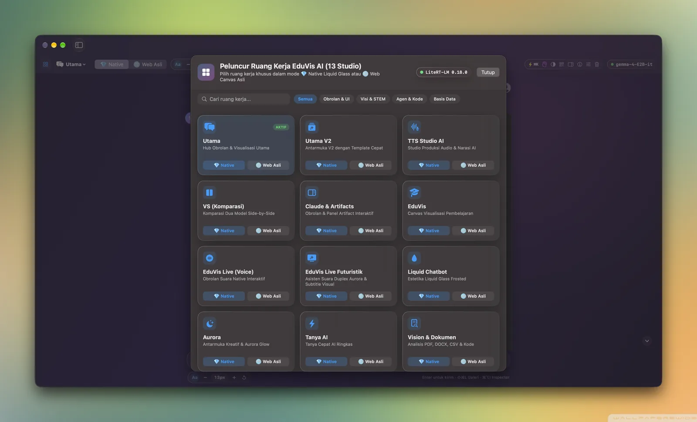 | 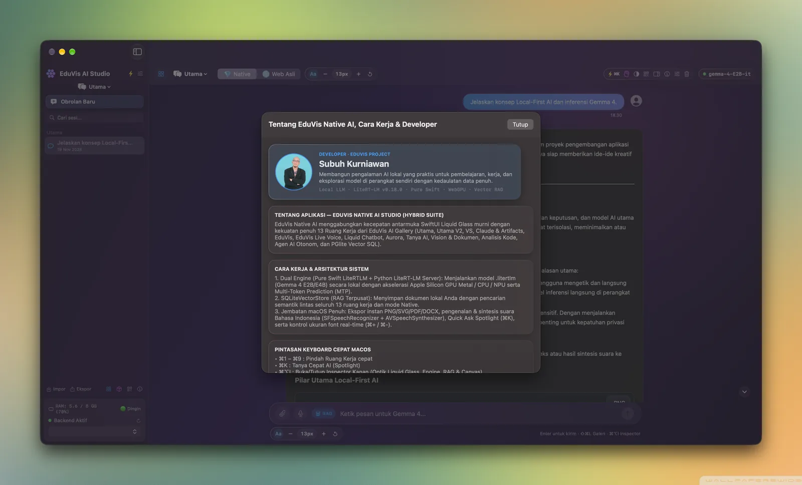 |

### Tampilan Responsif Multi-Perangkat (iPhone, MacBook, & iPad via LAN HTTPS)

| Chat & Rumus KaTeX Lintas Perangkat (LAN HTTPS) | EduVis Live Futuristik Lintas Perangkat (LAN HTTPS) |
| :---: | :---: |
| 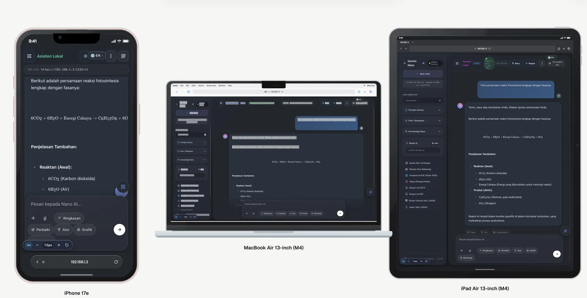 | 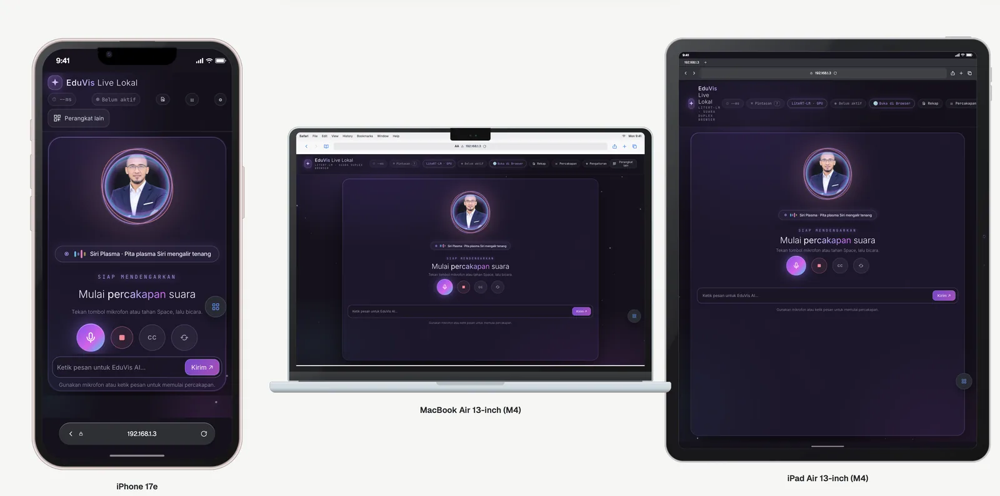 |

---

## 🌟 Fitur Utama & Ruang Kerja

| Ruang Kerja | File / Modul | Kegunaan Utama |
| :--- | :--- | :--- |
| **Portal Utama** | [`index.html`](index.html) | Gerbang navigasi ke seluruh workspace, petunjuk pemuatan model, dan status layanan. |
| **Chat Utama & V2** | [`utama.html`](utama.html), [`utamaV2.html`](utamaV2.html) | Obrolan AI lokal via LiteRT-LM dengan Markdown, KaTeX, PrismJS, Chart.js, Mermaid, dan manajemen sesi JSON. |
| **VS (Komparasi)** | [`VS.html`](VS.html) | Perbandingan respons dua model secara berdampingan (*side-by-side*). |
| **Claude & Artifacts** | [`claude.html`](claude.html) | Obrolan dengan panel **Interactive Artifacts / Live Web Sandbox** 100% offline (HTML/CSS/SVG/JS + viewport responsif). |
| **EduVis (Edukasi)** | [`eduVis.html`](eduVis.html) | Mode pembelajaran visual terstruktur dengan dukungan grafik, flowchart, dan mindmap. |
| **EduVis Live** | [`gemini_live.html`](gemini_live.html) | Percakapan suara dua arah real-time dengan VAD/Push-to-Talk, TTS lokal VITS/Piper, avatar **Siri Live Sphere**, dan render visual. |
| **EduVis Live Futuristik** | [`gemini_live_futuristik.html`](gemini_live_futuristik.html) | Mode layar lebar sinematik/futuristik untuk interaksi suara hands-free dengan visualisasi sphere dan transkrip live. |
| **TTS Studio Lokal** | [`tts_studio_lokal.html`](tts_studio_lokal.html) | Studio sintesis suara lokal berbasis VITS Neural Indonesia, Piper News TTS, dan konversi suara RVC. |
| **Vision & Dokumen** | [`vision_ulti.html`](vision_ulti.html) | Ekstraksi & tanya-jawab dokumen PDF, Word, Excel, dan PPT secara offline. |
| **EduVis Native AI** | [`EduVisNativeApp/`](EduVisNativeApp/README.md) | Aplikasi macOS **100% Native SwiftUI** (Liquid Glass) mencakup 13 ruang kerja, Spotlight Quick Ask (`⌘K`), dan dikte suara native. |

---

## 🏗️ Arsitektur Sistem & Alur Lengkap

Proyek ini mendukung **dua jalur eksekusi utama** yang dapat digunakan secara mandiri maupun bersamaan:

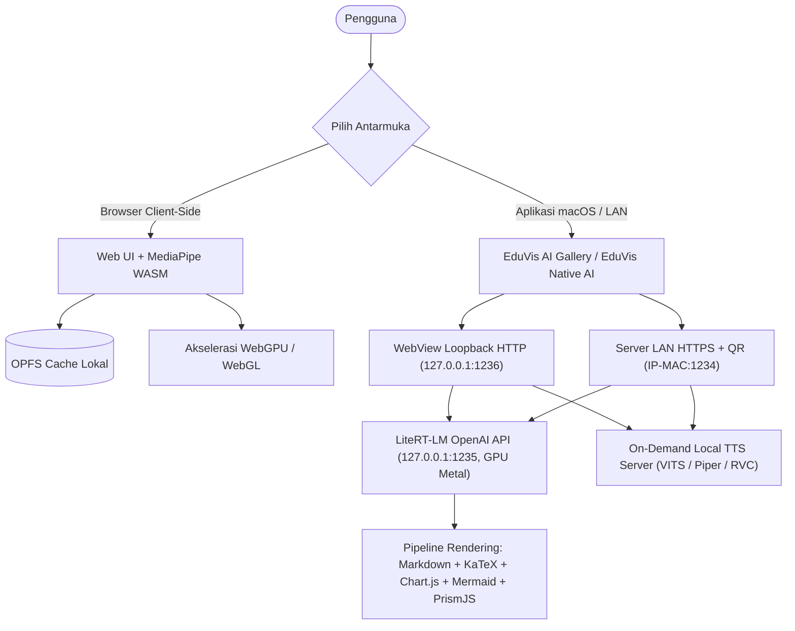

### Ringkasan Alur Kerja Utama
1. **Jalur Client-Side Murni (Browser WASM/WebGPU):**
   - Model `.task` / `.litertlm` diunduh sekali ke **Origin Private File System (OPFS)** browser (atau diunggah dari disk lokal).
   - Inferensi berjalan penuh di sandbox browser melalui WebAssembly & WebGPU tanpa backend.
2. **Jalur Desktop & LAN (EduVis AI Gallery & EduVis Native AI):**
   - Launcher Python ([`gemma_chat_gui.py`](gemma_chat_gui.py)) menyalakan layanan internal **LiteRT-LM** di `127.0.0.1:1235` dengan backend GPU.
   - WebView macOS terhubung melalui loopback HTTP (`http://127.0.0.1:1236`), sedangkan perangkat lain di Wi-Fi yang sama mengakses portal via HTTPS (`https://IP-MAC:1234`).
   - **TTS Server Lokal** ([`tts_server.py`](tts_server.py)) dinyalakan secara *on-demand* saat dibutuhkan oleh EduVis Live atau TTS Studio, serta memiliki pembersihan memori otomatis saat idle.
   - Seluruh respons streaming dirender secara dinamis ke Markdown, rumus matematika (KaTeX), grafik (Chart.js), diagram (Mermaid), dan syntax highlighting (PrismJS).

---

## 🎙️ Alur Mode EduVis Live & EduVis Live Futuristik

Mode **EduVis Live** ([`gemini_live.html`](gemini_live.html)) dan **EduVis Live Futuristik** ([`gemini_live_futuristik.html`](gemini_live_futuristik.html)) ditenagai bersama oleh pengendali percakapan [`live-conversation.js`](live-conversation.js) dan visualizer [`siri_live_sphere.js`](nano_asset/assets/avatars/siri_live_sphere.js).

### Diagram Alur Percakapan Suara Real-Time

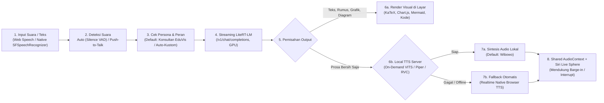

### Tahapan Lengkap di Balik Layar
1. **Penerimaan Input & Silence VAD:**
   - Pengguna dapat berbicara langsung pada mode **Auto (VAD)** — jeda diam otomatis mengakhiri kalimat dan mengirim transkrip — atau memakai mode **Push-to-Talk** maupun input teks biasa.
   - Di aplikasi macOS (`EduVis AI Gallery` & `EduVis Native AI`), izin mikrofon ditangani langsung melalui `WKUIDelegate` dan dukungan *silence VAD*.
2. **Nama Asisten & Pergantian Peran Otomatis:**
   - Peran bawaan AI adalah **Konsultan Profesional EduVis** untuk berbagai topik.
   - Nama asisten menyesuaikan gender suara TTS yang aktif: **Narendra** (suara pria) atau **Arsi** (suara perempuan, default bila gender tidak dikenali).
   - Jika pengguna meminta pergantian peran lewat suara atau teks (misalnya *"ganti peran menjadi tutor matematika"* atau *"berperan sebagai konsultan hukum"*), persona otomatis beralih ke **Kustom** dengan instruksi baru tersebut.
3. **Streaming Respons & Filter Prosa untuk TTS:**
   - Respons dari LiteRT-LM di-stream langsung ke layar sambil merender **KaTeX**, **Chart.js**, **Mermaid** (flowchart/mindmap), dan blok kode.
   - Mesin TTS secara otomatis **hanya membacakan teks prosa** — isi blok kode, konfigurasi grafik, dan sintaks diagram dilewati agar suara tetap natural.
4. **Sintesis Suara On-Demand & Fallback Otomatis:**
   - Suara TTS lokal bawaan adalah **Wibowo** melalui server TTS lokal ([`tts_server.py`](tts_server.py)) yang aktif secara *on-demand*.
   - Jika sintesis atau pemutaran TTS lokal gagal, sesi otomatis beralih ke **Realtime Native** (suara bahasa Indonesia bawaan sistem/browser) tanpa memutus percakapan.
5. **Visualisasi Siri Live Sphere & Barge-In (Potong Bicara):**
   - Audio diputar melalui *shared* `AudioContext` yang dihangatkan sejak awal untuk latensi minimal, menggerakkan animasi **Siri Live Sphere** (`execFemale`, `execMale`, atau ilustrasi `Arsi` / `Narendra`) secara sinkron saat AI berbicara.
   - Pengguna dapat memotong pembicaraan AI (*interrupt / barge-in*) kapan saja untuk langsung memberikan pertanyaan berikutnya.

### Perbandingan `gemini_live.html` vs `gemini_live_futuristik.html`

| Aspek | EduVis Live (`gemini_live.html`) | EduVis Live Futuristik (`gemini_live_futuristik.html`) |
| :--- | :--- | :--- |
| **Gaya Antarmuka** | Panel kontrol lengkap & manajemen sesi percakapan | Layar lebar sinematik (*widescreen HUD stage*) fokus pada sphere & transkrip live |
| **Avatar / Visualizer** | Siri Live Sphere (`execMale`, `execFemale`, ilustrasi `Arsi` & `Narendra`) | Siri Live Sphere utama di panggung futuristik dengan riak audio real-time |
| **Penyimpanan Preferensi** | Persona, persona kustom, model, suara, & pilihan fallback TTS disimpan permanen di `localStorage` | Preferensi sesi cepat; fallback TTS ke Realtime Native berlaku selama sesi berjalan |
| **Kontrol Tambahan** | Pengaturan endpoint lengkap, tombol pintas ke **TTS Studio Lokal**, layar penuh, & Wake Lock | Kontrol ringkas hands-free, layar transkrip terfokus, & `Screen Wake Lock` agar layar tidak redup |

---

## 🤖 Dukungan Model LLM & Spesifikasi Perangkat

### Varian Model Gemma 4 (`.litertlm` / `.task` / `.bin`)
1. **Gemma 4 E2B-it (1.6B parameter aktif):** Sangat ringan & cepat (~2 GB RAM/VRAM). Ideal untuk perangkat spesifikasi ringan/menengah.
2. **Gemma 4 E4B-it (2.7B parameter aktif):** Keseimbangan optimal antara kecepatan dan kedalaman penalaran.
3. **Gemma 4 12B-it:** Penalaran menengah yang kuat (disarankan RAM minimal 16 GB).
4. **Gemma 4 26B-A4B-it & 31B-it:** Untuk tugas kompleks (disarankan RAM/VRAM minimal 32 GB).

### Kebutuhan Perangkat Keras

| Komponen | Minimum (Model E2B / E4B) | Rekomendasi (Model 12B ke atas) |
| :--- | :--- | :--- |
| **GPU / VGA** | Apple M-Series / Intel Iris Xe / AMD Radeon Vega (WebGL 2.0 / WebGPU) | Apple M-Series Pro/Max atau GPU Diskrit NVIDIA RTX / AMD RX (WebGPU penuh) |
| **RAM / VRAM** | 8 GB RAM (2 GB VRAM) | 16 GB – 32 GB+ RAM (6–8 GB+ VRAM) |
| **Penyimpanan** | 5 GB kosong (SSD disarankan) | 15 GB – 30 GB kosong (SSD NVMe) |
| **Browser** | Chrome / Edge v113+ | Chrome / Edge v120+ (WebGPU aktif) |

---

## 📦 Instalasi & Unduh Model Mandiri

Bobot model berukuran besar (embedding `multilingual-e5-small`, `all-MiniLM-L6-v2`, model TTS Indonesia VITS, serta aset opsional ONNX/RVC) tidak disimpan di repositori Git agar ukuran repo tetap ringan (~48 MB tanpa Git LFS).

### 1. Clone Repositori & Unduh Model Otomatis
```bash
git clone https://github.com/subuh-kurniawan/EduVis-AI-Galery.git
cd EduVis-AI-Galery

# Unduh model publik (embedding & TTS Indonesia) ke path lokal yang sesuai
python3 scripts/download_models.py

# Opsional: unduh juga aset GitHub Releases (assets-v1) dan suara Piper
python3 scripts/download_models.py --all
```

### 2. Siapkan File Model LLM (`.litertlm` / `.task`)
- **Via Aplikasi macOS (Pusat Model):** Buka **Pusat Model…** pada launcher, lalu seret file `.litertlm` (unduh dari [Hugging Face LiteRT Community](https://huggingface.co/litert-community)) atau impor dari folder proyek.
- **Via Browser (Client-Side):** Pilih model dari dropdown untuk unduhan otomatis ke cache OPFS, letakkan file `.task`/`.litertlm` di root folder proyek, atau unggah langsung lewat tombol **Atau Unggah Model**.

### 3. Suara Piper Indonesia (Opsional)
Untuk menambahkan suara **News TTS** pada TTS Studio dan EduVis Live:
```bash
.venv_tts/bin/python3 -m pip install -r requirements-piper.txt
.venv_tts/bin/python3 scripts/download_piper_news_voice.py
```
> Model Piper disimpan di `models/piper/` (diabaikan oleh Git). Runtime Piper berlisensi GPL-3.0-or-later; periksa lisensi dataset sumber sebelum distribusi ulang.

---

## 🚀 Cara Menjalankan Aplikasi

### Opsi 1: Aplikasi Desktop macOS (EduVis AI Gallery)
```bash
python3 gemma_chat_gui.py
```
Atau klik dua kali [`Jalankan Gemma AI Gallery.command`](Jalankan%20Gemma%20AI%20Gallery.command).
- Pada eksekusi pertama, launcher memasang bundle **EduVis AI Gallery.app** ke `~/Applications/` dan menyiapkan runtime `litert-lm` di virtual environment khusus (`~/Library/Application Support/Gemma AI Gallery/`).
- Menutup jendela aplikasi otomatis menghentikan server UI/API, LiteRT-LM, dan seluruh proses turunannya.
- Jika aset lama masih muncul di WebView, klik tombol **Muat Ulang** (ikon panah melingkar di kanan atas) untuk membersihkan cache WebKit tanpa menghapus riwayat chat.

### Opsi 2: Server Web Lokal (Browser / Lintas Platform)
Karena fitur WebAssembly membutuhkan header COOP/COEP, jalankan server lokal (bukan membuka `file://` secara langsung):

```bash
# Direkomendasikan (dengan header keamanan WASM COOP/COEP)
python3 server.py
# Port kustom: python3 server.py 8080
```
Lalu buka `http://localhost:8000` di Chrome atau Edge. Alternatif lain: `python3 -m http.server 8000` atau ekstensi **VS Code Live Server**.

---

## 🍎 Panduan Build Aplikasi macOS (EduVis AI Gallery & EduVis Native AI)

**Prasyarat:**
- macOS 14.0+ (Sonoma atau lebih baru, disarankan Apple Silicon)
- Xcode Command Line Tools (`xcode-select --install` — menyediakan `swiftc`, `xcrun`, dan `hdiutil`)
- Python 3.10+
- Model pendukung sudah diunduh via `python3 scripts/download_models.py`

### 1. Build **EduVis AI Gallery** (WebView + Launcher + LAN HTTPS)
- **Build bundle mandiri `.app` saja** (menghasilkan `EduVis AI Gallery.app` di folder proyek):
  ```bash
  python3 scripts/build_dmg.py --app-only
  ```
- **Build/perbarui dan langsung jalankan:**
  ```bash
  python3 gemma_chat_gui.py
  ```

### 2. Build **EduVis Native AI** (100% Native SwiftUI Liquid Glass)
```bash
cd EduVisNativeApp
chmod +x build_native_app.sh
./build_native_app.sh
```
Jalankan hasil build:
```bash
open "EduVisNativeApp/EduVis Native AI.app"
```
Detail 13 ruang kerja native tersedia di [`EduVisNativeApp/README.md`](EduVisNativeApp/README.md).

### 3. Build Installer **DMG** Lengkap (Keduanya dalam 1 Paket)
Mengompilasi dan mengemas **EduVis AI Gallery.app** serta **EduVis Native AI.app** ke dalam `dist/EduVis-AI-Gallery-macOS.dmg`:
```bash
python3 scripts/build_dmg.py
```
Jika kedua `.app` sudah ada dan hanya ingin mengemas ulang `.dmg`:
```bash
python3 scripts/build_dmg.py --dmg-only
```

> **Catatan Gatekeeper macOS:** Karena aplikasi dibangun secara lokal (*ad-hoc signing*), saat pertama kali dibuka di Mac lain, klik kanan ikon aplikasi → pilih **Open / Buka**.

---

## 🌐 Akses Multi-Perangkat di LAN HTTPS & QR Code

Saat **EduVis AI Gallery** aktif, server menyediakan portal HTTPS pada port `1234` untuk perangkat lain di Wi-Fi yang sama:
- **Portal:** `https://IP-MAC:1234/` (atau langsung `/utama.html`, `/VS.html`, `/claude.html`, `/eduVis.html`, `/gemini_live.html`, `/gemini_live_futuristik.html`)
- **API OpenAI-Compatible:** `https://IP-MAC:1234/v1` (gunakan spesifikasi model seperti `gemma-3n-E4B,gpu` untuk backend GPU)
- **QR Code Lokal:** Klik tombol **Perangkat lain** di UI Utama, VS, atau Claude untuk memindai QR langsung dari ponsel/tablet.

### Mempercayai Sertifikat CA Lokal (Wajib untuk Akses Mikrofon di Klien LAN)
Unduh sertifikat DER dari `https://IP-MAC:1234/api/lan-ca` (file CA tersimpan di `~/Library/Application Support/Gemma AI Gallery/lan-tls/lan-ca.pem`):
- **macOS Klien:** Impor ke *Keychain Access* (`login`) → buka sertifikat → bagian **Trust** → pilih **Always Trust**.
- **iPhone / iPad:** Unduh profil → **Settings → Profile Downloaded** → aktifkan kepercayaan penuh di **Settings → General → About → Certificate Trust Settings**.

> **Peringatan Keamanan:** Server LAN tidak menggunakan autentikasi. Gunakan hanya di jaringan lokal tepercaya dan jangan meneruskan port `1234` ke internet publik.

---

## 🖼️ Ekspor Visualisasi & Uji Regresi

- **Flowchart & Mindmap:** Menggunakan Mermaid dengan normalisasi otomatis (menjaga label edge, mengutip tanda baca di node mindmap, serta mendukung konversi `flowchart`/`markmap`).
- **Ekspor Visual:** Grafik Chart.js dan tabel Markdown menyediakan tombol **PNG**; toolbar Mermaid menyediakan **SVG** dan **PNG**. Di aplikasi macOS, ekspor membuka dialog simpan native.
- **Uji Regresi Rendering** (menggunakan test runner bawaan Node.js tanpa `npm install`):
  ```bash
  npm run test:regressions
  ```
- **Pemeriksaan Tipe Swift WebView:**
  ```bash
  xcrun swiftc -sdk "$(xcrun --show-sdk-path --sdk macosx)" -target arm64-apple-macosx13.0 -typecheck gemma_webview.swift
  ```

---

## 📂 Struktur File Utama

- [`index.html`](index.html): Portal utama pemilih workspace & panduan awal.
- [`utama.html`](utama.html), [`VS.html`](VS.html), [`claude.html`](claude.html), [`eduVis.html`](eduVis.html): Workspace chat, komparasi, artifacts, dan edukasi.
- [`gemini_live.html`](gemini_live.html) & [`gemini_live_futuristik.html`](gemini_live_futuristik.html): Antarmuka percakapan suara real-time (standar & futuristik).
- [`live-conversation.js`](live-conversation.js): Mesin percakapan suara, VAD, streaming LiteRT-LM, TTS on-demand, dan barge-in.
- [`tts_studio_lokal.html`](tts_studio_lokal.html) & [`tts_server.py`](tts_server.py): Antarmuka & server lokal TTS Neural (VITS, Piper, RVC).
- [`vision_ulti.html`](vision_ulti.html): Asisten pembaca dokumen & visualisasi data offline.
- [`gemma_chat_gui.py`](gemma_chat_gui.py) & [`gemma_webview.swift`](gemma_webview.swift): Launcher macOS, manajemen LiteRT-LM, server LAN HTTPS, dan WebView native.
- [`EduVisNativeApp/`](EduVisNativeApp/README.md): Kode sumber aplikasi macOS 100% Native SwiftUI.
- [`scripts/download_models.py`](scripts/download_models.py) & [`scripts/build_dmg.py`](scripts/build_dmg.py): Skrip unduh model mandiri & pembangun bundle/DMG macOS.
- [`server.py`](server.py) & [`bundle.js`](bundle.js): Server web lokal (COOP/COEP) dan modul MediaPipe LLM Inference.
- `nano_asset/`: Pustaka JS/CSS lokal, avatar Siri Live Sphere, dan aset offline.

---

## 🛠️ Troubleshooting & FAQ

1. **"WebGPU is not supported / detected":** Gunakan Chrome/Edge terbaru. Di Linux/beberapa sistem, aktifkan `chrome://flags/#enable-unsafe-webgpu` lalu relaunch browser.
2. **Tab/Browser crash (Out of Memory):** Model melebihi kapasitas RAM/VRAM. Muat ulang halaman dan pilih varian lebih kecil (misalnya **E2B-it** atau **E4B-it**).
3. **Mikrofon ditolak di perangkat LAN lain:** Pastikan sertifikat CA lokal dari `https://IP-MAC:1234/api/lan-ca` sudah diinstal dan dipercaya (*Always Trust*), lalu muat ulang halaman.
4. **Suara TTS lokal tidak keluar di EduVis Live:** Sistem akan otomatis beralih ke **Realtime Native**. Pastikan model TTS sudah diunduh via `python3 scripts/download_models.py` jika ingin memakai suara lokal VITS (Wibowo).

---

## 🙏 Kredit & Atribusi Open-Source

Fitur **TTS Lokal** dan percakapan suara pada EduVis AI Gallery dibangun dengan memanfaatkan serta menghargai karya proyek-proyek open-source berikut:

- **[drat/TTS-Indonesia-Gratis](https://github.com/drat/TTS-Indonesia-Gratis)** — Implementasi TTS lokal bahasa Indonesia, Jawa, dan Sunda berbasis G2P & VITS beserta profil suara bawaan (**Wibowo**, **Ardi**, **Gadis**, **Juminten**, **Asep**).
- **[Wikidepia/indonesian-tts](https://github.com/Wikidepia/indonesian-tts)** — Pelatihan dan rilis model VITS TTS Bahasa Indonesia (`checkpoint_1260000-inference.pth`). *Catatan lisensi dari pembuat model: **khusus non-komersial (DO NOT USE FOR COMMERCIAL PURPOSES)**.*
- **[coqui-ai/TTS](https://github.com/coqui-ai/TTS)** — Mesin sintesis suara neural VITS.
- **[rhasspy/piper](https://github.com/rhasspy/piper)** & **[okasi/piper-indonesian-news-tts-onnx-q8](https://huggingface.co/okasi/piper-indonesian-news-tts-onnx-q8)** — Runtime Piper (GPL-3.0-or-later) dan model suara opsional **News TTS** Bahasa Indonesia (ONNX Q8).
- **[RVC-Project/Retrieval-based-Voice-Conversion-WebUI](https://github.com/RVC-Project/Retrieval-based-Voice-Conversion-WebUI)** — Pipeline inferensi konversi suara opsional (RVC & RMVPE).

---

## 📖 Referensi Resmi

- [Dokumentasi MediaPipe Web LLM Inference API](https://ai.google.dev/edge/mediapipe/solutions/genai/llm_inference/web_js)
- [Koleksi Model LiteRT Community di Hugging Face](https://huggingface.co/litert-community)
- [Gemma 4 Model Hub di Hugging Face](https://huggingface.co/models?search=gemma-4)
