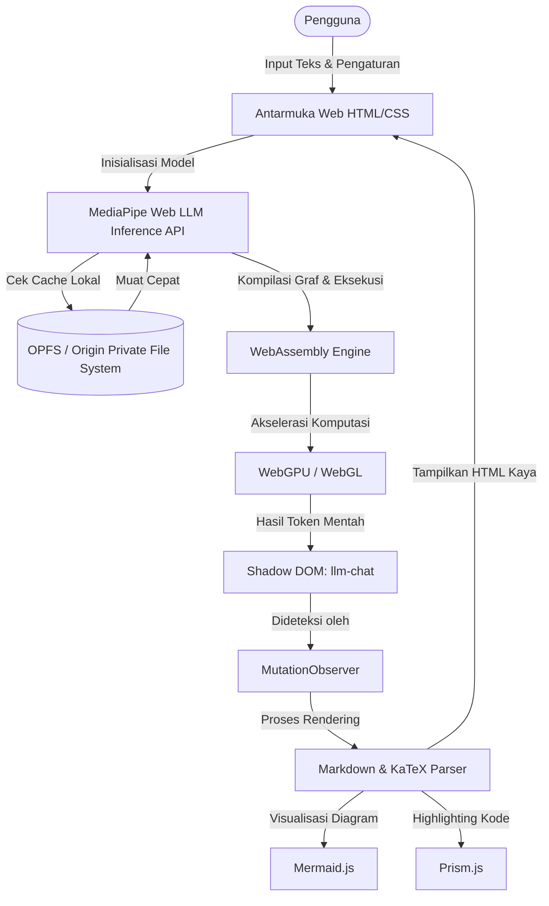

# 🤖 Gemma 4 Web Chat & Nano AI Assistant

Gemma 4 Web Chat adalah antarmuka web modern untuk berinteraksi dengan model **Gemma 4** secara penuh di sisi klien (*on-device/fully in-browser*) menggunakan **MediaPipe Web LLM Inference API** dan WebAssembly (WASM). Proyek ini menghilangkan kebutuhan akan server backend atau kunci API berbayar, memberikan privasi penuh karena data tidak pernah meninggalkan perangkat Anda.

Proyek ini merupakan penyederhanaan dari [MediaPipe Samples](https://github.com/google-ai-edge/mediapipe-samples/tree/main/examples/llm_inference/llm_chat_ts/) dengan penyesuaian khusus untuk ekosistem Gemma 4, penghapusan autentikasi yang rumit, serta peningkatan UI/UX secara signifikan.

---

## 🌟 Fitur Utama

- ⚡ **100% Client-Side & Privat:** Seluruh proses inferensi AI berjalan langsung di browser perangkat Anda tanpa server perantara. Data Anda aman dan tidak pernah dikirim ke pihak ketiga.
- 📦 **Penyimpanan Lokal (OPFS Caching):** Mengunduh model otomatis sekali saja ke Origin Private File System (OPFS) browser, sehingga pemuatan berikutnya berjalan secara instan.
- 🧮 **Akselerasi Perangkat Keras:** Memanfaatkan WebAssembly (WASM) dan WebGPU/WebGL untuk performa inferensi yang optimal mendekati aplikasi native.
- 🟢 **Status Model dan Koneksi:** Indikator lintas halaman membedakan model yang belum dipilih, koneksi yang sedang diuji, API yang terhubung, dan layanan yang tidak tersedia.
- 🗂️ **Manajemen Sesi:** Cari sesi tersimpan berdasarkan nama atau isi percakapan, ubah nama sesi, serta ekspor sesi individual atau seluruh sesi sebagai JSON untuk dicadangkan dan diimpor kembali. Impor memvalidasi format sesi, membuang ID database sumber, dan melaporkan entri yang dilewati.
- 🎨 **Visualisasi Lengkap:** Render antarmuka yang dinamis dengan dukungan format Markdown, LaTeX untuk matematika, penyorotan sintaks kode PrismJS, dan visualisasi bagan otomatis dengan MermaidJS.
- 🖼️ **Ekspor Visualisasi:** Grafik Chart.js dan tabel Markdown dapat diunduh sebagai PNG; diagram Mermaid tetap menyediakan unduhan SVG dan PNG melalui toolbar diagram.
- 📄 **Asisten Dokumen Cerdas (`vision_ulti.html`):** Ekstraksi dan tanya-jawab instan dari dokumen berformat PDF, Word, Excel, maupun presentasi PPT secara offline.
- 🧪 **Interactive Artifacts & Live Web Sandbox:** Menjalankan kode HTML, CSS, SVG, dan JavaScript interaktif di panel terpisah (ala Claude Artifacts/Canvas) secara 100% offline dengan injeksi Tailwind lokal, penangkap error/konsol real-time, simulasi viewport responsif (Mobile/Tablet/Desktop), dan tombol *"Perbaiki dengan AI"*.

---

## 🤖 Dukungan Model LLM

Aplikasi ini mendukung berbagai varian model **Gemma 4** terkuantisasi (format `.bin`/`.task`/`.litertlm` untuk MediaPipe):

1. **Gemma 4 E2B-it (1.6B parameter aktif):** Sangat ringan, cepat, membutuhkan memori minimal (~2GB VRAM/RAM). Cocok untuk perangkat dengan spesifikasi rendah/sedang.
2. **Gemma 4 E4B-it (2.7B parameter aktif):** Keseimbangan yang baik antara kecepatan dan pemahaman konteks dasar.
3. **Gemma 4 12B-it:** Model dengan kemampuan penalaran menengah yang kuat, disarankan untuk perangkat dengan RAM minimal 16GB dan GPU diskrit.
4. **Gemma 4 26B-A4B-it & 31B-it:** Model kelas berat untuk instruksi kompleks. Membutuhkan spesifikasi PC/Mac kelas atas dengan kapasitas RAM/VRAM minimal 32GB.

*Catatan: Model akan diunduh secara otomatis dari repository komunitas Hugging Face saat Anda memilihnya pertama kali di menu dropdown aplikasi.*

---

## 🏗️ Arsitektur Sistem & Aliran Data

Aplikasi ini berjalan dengan arsitektur **Serverless Client-Side**. Seluruh eksekusi AI dan manajemen data terjadi langsung di dalam sandbox browser pengguna.



### 1. Engine Inferensi (MediaPipe & LiteRT)
- **LiteRT (TensorFlow Lite untuk Edge AI):** Model Gemma 4 dikonversi ke format `.task` atau `.litertlm` yang dioptimalkan untuk eksekusi berdaya rendah.
- **WebAssembly (WASM) & GPU Delegation:** Komputasi matematika neural network didelegasikan ke GPU perangkat keras menggunakan standardisasi **WebGPU** atau **WebGL** melalui WebAssembly (WASM), menghasilkan kecepatan inferensi mendekati native.

### 2. Manajemen Memori & Cache (OPFS)
- **Origin Private File System (OPFS):** Untuk menghindari pengunduhan ulang file model berukuran gigabyte pada setiap kunjungan halaman, aplikasi menggunakan API OPFS browser (`navigator.storage.getDirectory()`). File model disimpan di penyimpanan sandboxed berkinerja tinggi langsung pada hard disk lokal Anda dan dimuat secara instan.

### 3. Rendering Interseptor (Shadow DOM & MutationObserver)
- Komponen chat bawaan berjalan di dalam *Shadow DOM* yang terisolasi. Aplikasi menggunakan `MutationObserver` untuk mendeteksi penambahan token teks mentah secara real-time dari model.
- Begitu token baru muncul, interseptor memicu pipeline parsing untuk mengonversi teks mentah menjadi representasi visual kaya dengan dukungan Markdown, LaTeX, Mermaid, dan PrismJS.

---

## 💻 Spesifikasi & Kebutuhan Perangkat Keras (Hardware Requirements)

Menjalankan Large Language Model (LLM) langsung di dalam browser membutuhkan spesifikasi perangkat keras tertentu agar berjalan dengan lancar dan responsif:

| Komponen | Spesifikasi Minimum (Model E2B / E4B) | Spesifikasi Rekomendasi (Model 12B ke atas) |
| :--- | :--- | :--- |
| **GPU / VGA** | Terintegrasi (Intel Iris Xe, AMD Radeon Vega, Apple M-Series) dengan dukungan WebGL 2.0 / WebGPU | Kartu Grafis Diskrit (NVIDIA GTX/RTX, AMD RX, Apple M-Series Pro/Max) dengan dukungan penuh **WebGPU** |
| **VRAM** | Minimal 2 GB | Disarankan 6 GB - 8 GB atau lebih |
| **RAM Sistem** | 8 GB | 16 GB atau lebih |
| **Penyimpanan** | Sisa ruang kosong minimal 5 GB (SSD sangat disarankan untuk loading cepat OPFS) | Sisa ruang kosong minimal 15 GB - 30 GB (SSD NVMe) |
| **Browser** | Chrome v113+, Edge v113+, Opera, atau Chromium-based lainnya | Chrome v120+ (dengan flag WebGPU aktif jika diperlukan) |

### 🍎 Kebutuhan Khusus macOS (Mac)
- **Apple Silicon (M-Series - M1/M2/M3/M4 & varian Pro/Max/Ultra):** Sangat direkomendasikan karena arsitektur *Unified Memory* (RAM sistem digunakan bersama sebagai VRAM). Model 12B ke atas membutuhkan setidaknya Mac dengan RAM 16 GB atau lebih besar.
- **Mac Berbasis Intel:** Memerlukan GPU diskrit AMD Radeon dengan dukungan WebGL2/WebGPU yang memadai. RAM minimal 16 GB.
- **Browser:** Gunakan **Google Chrome** atau **Microsoft Edge** versi terbaru untuk performa WebGPU terbaik. Safari saat ini masih membutuhkan aktivasi WebGPU secara manual melalui menu *Feature Flags/Developer*.

### 💻 Kebutuhan Khusus PC (Windows / Linux)
- **NVIDIA GPU:** Sangat direkomendasikan seri RTX (RTX 30-series atau lebih baru) dengan driver terbaru yang mendukung WebGPU secara native.
- **AMD GPU:** Seri RX 6000 atau lebih baru dengan driver Vulkan/DirectX 12 terbaru.
- **Sistem RAM & VRAM:** RAM minimum 16 GB sangat dianjurkan agar OS dan browser tidak kekurangan memori saat mengalokasikan buffer untuk GPU.
- **Browser di Linux:** Untuk beberapa distro Linux, Anda mungkin perlu mengaktifkan flag WebGPU secara manual di Chrome (`chrome://flags/#enable-unsafe-webgpu`) tergantung pada driver grafis yang digunakan.

---

## 🚀 Cara Menjalankan & Menyiapkan Model secara Lokal

Karena proyek ini menggunakan fitur WebAssembly tingkat lanjut dan memuat file model lokal, browser Anda memerlukan lingkungan server web lokal (bukan sekadar membuka file HTML secara langsung menggunakan `file://`).

### EduVis AI Gallery

Aplikasi desktop **EduVis AI Gallery** menampilkan launcher native macOS dengan struktur visual yang mengikuti portal `index.html`, sambil mempertahankan banner, keterangan teknologi, pemilih workspace, status kesiapan model, dan tombol **Mulai** native. Saat pertama dibuka, jendela memakai 80% lebar dan 85% tinggi area layar, diposisikan di tengah sebelum ditampilkan. Ukuran dapat diubah secara fleksibel pada kedua arah, dengan batas minimum 50% viewport dan maksimum sebesar viewport layar aktif; mode fullscreen native juga tersedia. Pemulihan state jendela AppKit dinonaktifkan agar tidak menimpa ukuran awal. Bundle aplikasi menyertakan ikon EduVis khusus untuk Dock dan dialog native; portal juga memakai favicon SVG yang seragam. Pilih Utama, VS, Claude, EduVis, atau EduVis Live melalui pemilih workspace untuk membukanya di jendela Swift/WebKit. Tombol **Pilih tampilan** membawa Anda kembali ke launcher. Simpan `Banner.jpg` di folder proyek bersama launcher. LiteRT-LM menjalankan model bahasa seperti Gemma pada service lokal, yang diakses antarmuka melalui API kompatibel OpenAI. Launcher menggunakan Swift dan AppKit; antarmuka ditulis dengan HTML, CSS, dan JavaScript di WebKit; Python mengelola service dan server lokal:

```bash
python3 gemma_chat_gui.py
```

Atau, di macOS, klik dua kali file **Jalankan Gemma AI Gallery.command** di folder proyek untuk membangun/memperbarui aplikasi di `~/Applications/` dan membukanya. Jika dibuka dari Terminal, jendela Terminal disembunyikan oleh aplikasi native setelah splash screen tampil; bila startup gagal sebelum jendela terbuka, Terminal tetap terlihat untuk menampilkan pesan error.

Aplikasi dijalankan dengan Python 3 serta memerlukan `swiftc`, `xcrun`, dan file model `.litertlm`. Launcher memasang bundle **EduVis AI Gallery.app** ke `~/Applications/`; setelah pemasangan pertama, aplikasi dapat dibuka langsung dari folder Applications atau Launchpad dan akan menyalakan server/model di background. Tutup aplikasi untuk menghentikan backend. Jika perintah `litert-lm` belum tersedia, launcher memerlukan Python 3.10 atau lebih baru untuk memasangnya otomatis ke virtual environment khusus aplikasi di `~/Library/Application Support/Gemma AI Gallery/`, tanpa mengubah instalasi Python sistem. Pemasangan pertama memerlukan koneksi internet.

Launcher native menyediakan **Pusat Model** untuk melihat status LiteRT-LM, memilih model aktif, menghapus model, atau mengimpor file `.litertlm`. Seret file model ke area impor atau pilih file melalui dialog. Unggahan model native dibatasi ke koneksi loopback komputer host dan file berukuran maksimal 100 GB.

Jika halaman WebView masih menampilkan aset lama, klik tombol muat ulang (ikon panah melingkar) di kanan atas jendela native. Tombol ini menghapus cache disk dan memori WebKit lalu memuat ulang halaman dari origin; riwayat chat dan preferensi yang disimpan di IndexedDB/localStorage tidak dihapus.

Untuk mengimpor model, letakkan file `.litertlm` langsung di folder proyek, buka **Atur** pada sidebar UI utama, pilih file di bagian **Impor Model Lokal**, lalu klik **Impor ke LiteRT-LM**. ID model otomatis diisi dari nama file dan bisa diubah sebelum impor.

Daftar model yang sudah diimpor dapat dilihat pada bagian **Model Terimpor** di pengaturan LiteRT-LM pada UI utama maupun UI VS dan Claude. Gunakan **Pilih** untuk mengaktifkan model; **Hapus** akan meminta konfirmasi dan menghapus model secara permanen menggunakan `litert-lm delete`.

Server UI dan API memakai HTTPS di port `1234`: dari perangkat lain di jaringan, buka portal `https://IP-MAC:1234/` atau `https://IP-MAC:1234/index.html`. Portal menyediakan navigasi ke Utama, VS, EduVis, Claude, dan EduVis Live; halaman-halaman tersebut juga dapat dibuka langsung dengan `https://IP-MAC:1234/utama.html`, `/VS.html`, `/eduVis.html`, `/claude.html`, atau `/gemini_live.html`. EduVis Live memakai pengenalan suara browser untuk input, lalu mengirim transkrip ke LiteRT-LM melalui `/v1/chat/completions` dengan backend GPU; pilih model pada pengaturan halaman tersebut. Nama AI EduVis Live mengikuti gender suara TTS yang dikenali: **Narendra** untuk suara pria dan **Arsi** untuk suara perempuan; suara tanpa gender yang diketahui mempertahankan nama sebelumnya (default **Arsi**). Persona, mode percakapan, pilihan suara/TTS, dan model disimpan di localStorage browser pada perangkat yang digunakan. Jawaban mendukung render rumus matematika (KaTeX), grafik (Chart.js), dan diagram Mermaid, flowchart, serta mindmap. TTS hanya membacakan prosa, bukan isi blok kode, grafik, atau diagram. Browser klien harus mempercayai CA lokal agar koneksi HTTPS dipercaya dan akses mikrofon diizinkan. Launcher menyimpan CA di `~/Library/Application Support/Gemma AI Gallery/lan-tls/lan-ca.pem` dan menyediakan sertifikat instalasi DER dari `https://IP-MAC:1234/api/lan-ca`. Pada Mac klien, unduh sertifikat, buka Keychain Access, pilih keychain **login**, lalu pilih **File → Import Items**. Buka sertifikat yang diimpor, perluas bagian **Trust**, dan ubah **When using this certificate** menjadi **Always Trust**. Pada iPhone/iPad, unduh sertifikat, pasang profil melalui **Settings → Profile Downloaded**, lalu aktifkan kepercayaan penuh di **Settings → General → About → Certificate Trust Settings**. Setelah CA dipercaya, muat ulang halaman dan izinkan mikrofon. Untuk WebView di Mac server, launcher mempertahankan HTTP yang hanya terikat ke loopback di `http://127.0.0.1:1236`; API internal LiteRT-LM tetap hanya mendengarkan pada `127.0.0.1:1235`. API LAN dapat diakses di `https://IP-MAC:1234/v1`. Launcher mendeteksi alamat IPv4 perangkat dan mencetak URL; CORS mengizinkan origin HTTPS LAN yang terdeteksi dan WebView loopback. Server lokal hanya melayani halaman UI yang diizinkan serta aset dari `nano_asset/assets/`; ia tidak menyajikan seluruh isi folder proyek. Chat dari UI menggunakan backend GPU; klien API lain dapat memilih GPU dengan model spec seperti `gemma-3n-E4B,gpu`. Menutup jendela menghentikan launcher, server UI/API, LiteRT-LM, dan proses turunannya. **Peringatan:** UI/API tidak memakai autentikasi. Perangkat lain di jaringan dapat memakai API serta operasi impor dan penghapusan model. Gunakan hanya di jaringan tepercaya dan jangan meneruskan port tersebut ke internet publik. Jika IP berubah saat aplikasi berjalan, mulai ulang aplikasi agar alamat serta SAN sertifikat dan CORS diperbarui.

#### Kondisi EduVis Live saat ini

- Peran bawaan AI adalah konsultan profesional EduVis untuk berbagai topik dan bidang. Nama asisten tetap **Arsi** atau **Narendra**, sesuai gender suara TTS yang dipilih; konsultan EduVis adalah peran, bukan nama.
- Jika pengguna secara eksplisit meminta perubahan peran—misalnya “ganti peran menjadi tutor matematika” atau “berperan sebagai konsultan hukum”—persona otomatis beralih ke **Kustom** dengan instruksi peran tersebut. Ini berlaku untuk input teks maupun suara. Pada `gemini_live.html`, persona kustom disimpan bersama preferensi browser.
- Suara TTS lokal bawaan adalah **Wibowo**. Jika sintesis atau pemutaran TTS lokal gagal, sesi beralih ke **Realtime Native** untuk melanjutkan jawaban. Suara native mengikuti suara bahasa Indonesia yang tersedia di browser/sistem dan dapat berbeda dari Wibowo. Halaman `gemini_live.html` menyimpan pilihan fallback; di halaman Futuristik, fallback berlaku selama sesi berjalan.

Portal `index.html` menampilkan petunjuk penggunaan dan pemuatan model saat pertama dibuka. Petunjuk menjelaskan pemilihan workspace, penempatan file `.litertlm`, serta impor dan pemilihan model dari pengaturan LiteRT-LM. Pilih **Jangan tampilkan otomatis lagi** untuk menyimpan pilihan pada browser/perangkat tersebut; petunjuk tetap dapat dibuka kembali melalui tombol **Petunjuk**.

UI utama, VS, dan Claude memiliki tombol **Perangkat lain** yang menampilkan QR code menuju portal klien. Pemindai QR dan generator berjalan sepenuhnya lokal; pemindaian membuka daftar navigasi dan petunjuk sertifikat. Pindai pada perangkat yang terhubung ke Wi-Fi yang sama. Jika browser perangkat menolak sertifikat HTTPS lokal, unduh dan percayai sertifikat CA melalui tautan pada modal QR sebelum membuka kembali halaman.

Flowchart dan mindmap menggunakan Mermaid. Instruksi model meminta format Mermaid dengan struktur standar; keluaran berlabel `flowchart` atau `markmap` juga dinormalisasi ke Mermaid sebelum dirender. Normalisasi menjaga label edge, mengutip label mindmap agar tanda baca seperti kurung tidak dibaca sebagai sintaks bentuk node, merapikan indentasi, membuat root jika belum ada, dan mengonversi mindmap Markdown sederhana ke sintaks Mermaid.

Grafik Chart.js dan tabel Markdown hasil render menyediakan tombol **PNG**. Ekspor grafik menggunakan canvas Chart.js yang sudah dirender; ekspor tabel menyimpan tampilan tabel tanpa mengubah isi sumbernya. Di aplikasi macOS, tombol PNG dan SVG membuka dialog simpan native; di browser, file diunduh melalui mekanisme browser. Toolbar Mermaid mempertahankan pilihan **SVG** dan **PNG**; SVG tetap tersedia sebagai format vektor, sedangkan PNG dibuat dari SVG hasil render.

### Uji Regresi Rendering

Perubahan yang menyentuh renderer sebaiknya menjalankan uji regresi ringan sebelum aplikasi dicoba kembali:

```bash
npm run test:regressions
```

Uji ini memakai test runner bawaan Node.js (tidak memerlukan `npm install`) untuk memeriksa normalisasi mindmap, menjaga normalisasi flowchart, memastikan format konfigurasi Chart.js berbungkus `{ "chart": ... }` tetap ditangani, dan menjaga fallback kode sumber jika pustaka Mermaid gagal dimuat pada halaman VS dan Claude. Implementasi dialog simpan PNG dan SVG native berada di `gemma_webview.swift`; pemeriksaan native dapat dilakukan dengan `xcrun swiftc -sdk "$(xcrun --show-sdk-path --sdk macosx)" -target arm64-apple-macosx13.0 -typecheck gemma_webview.swift`.

Launcher menyertakan kompatibilitas untuk chat teks Gemma 3n: LiteRT-LM `serve` dapat mengaktifkan FST constrained decoding secara otomatis, yang gagal saat membuat percakapan pada model ini. Constraint tetap digunakan jika API secara eksplisit meminta format respons terstruktur.

Jika skrip dijalankan dari Terminal.app, jendela Terminal disembunyikan selama aplikasi terbuka dan ditampilkan kembali setelah aplikasi ditutup. Terminal lain, seperti terminal terintegrasi VS Code, tidak disembunyikan.

### 📦 Menyiapkan File Model (`.task` / `.litertlm` / `.bin`)

Aplikasi ini memberikan fleksibilitas tinggi dalam memuat model AI:

1. **Unduhan Otomatis (Default):**
   Jika Anda memilih model dari daftar dropdown dan belum memilikinya di penyimpanan lokal, aplikasi akan otomatis mengunduh model dari Hugging Face dan menyimpannya ke cache OPFS browser Anda agar pemuatan berikutnya menjadi instan.

2. **Menyimpan Model di Folder Proyek (Offline Penuh):**
   Jika ingin menjalankan aplikasi secara offline penuh sejak awal tanpa menunggu unduhan browser, Anda dapat mengunduh berkas model secara manual terlebih dahulu:
   - Unduh model Gemma 4 `.task` (misalnya `gemma-4-E2B-it-web.task`) lalu letakkan file tersebut langsung di **root folder** proyek ini.
   - Untuk model Qwen, buat folder baru bernama `models` di dalam proyek, lalu letakkan berkas `.litertlm` di dalamnya dengan struktur: `models/Qwen3.5-2B_int8.litertlm`.

3. **Mengunggah Bebas dari Disk Lokal (Upload File):**
   Anda juga bisa menggunakan opsi **"Atau Unggah Model"** di bagian sidebar untuk langsung memilih berkas `.task`, `.litertlm`, atau `.bin` dari direktori mana saja di komputer Anda tanpa perlu menyalinnya ke dalam folder proyek.

---

### Metode 1: Menggunakan Skrip Python Bawaan (Sangat Direkomendasikan)
Jalankan skrip ini langsung dari terminal di folder proyek Anda:

```bash
python server.py
# Atau jika ingin menentukan port kustom (misal: 8080):
python server.py 8080
```

Setelah server aktif, buka **[http://localhost:8000](http://localhost:8000)** di browser Anda.

### Metode 2: Menggunakan server HTTP bawaan (Python Standar)
Jika Anda hanya ingin menjalankan server bawaan Python tanpa headers khusus:
```bash
python -m http.server 8000
```

### Metode 3: Menggunakan VS Code Live Server
1. Buka folder proyek di **VS Code**.
2. Instal ekstensi **Live Server**.
3. Klik tombol **Go Live** di sudut kanan bawah status bar VS Code.

### Unduh Model Berat secara Mandiri
Bobot model berukuran besar (embedding `multilingual-e5-small`, `all-MiniLM-L6-v2`, model TTS Indonesia VITS, serta aset opsional ONNX/RVC) tidak disimpan di repositori Git agar tetap ringan. Setelah `git clone`, unduh seluruh model secara otomatis ke lokasi lokal yang sesuai dengan:

```bash
python3 scripts/download_models.py
```

Untuk mengunduh juga aset opsional (GitHub Releases `assets-v1` dan suara Piper):

```bash
python3 scripts/download_models.py --all
```

### Suara Piper Indonesia (opsional)
Piper menyediakan satu suara tambahan bernama **News TTS** di TTS Studio dan halaman EduVis Live. Untuk memasangnya di runtime lokal:

```bash
.venv_tts/bin/python3 -m pip install -r requirements-piper.txt
.venv_tts/bin/python3 scripts/download_piper_news_voice.py
```

Mulai ulang aplikasi setelah pemasangan. Model ONNX dan konfigurasinya disimpan di `models/piper/` dan tidak masuk ke Git. Suara VITS yang sudah tersedia tetap menjadi pilihan terpisah. Piper runtime berlisensi GPL-3.0-or-later; model Hugging Face menyatakan MIT, tetapi lisensi dataset sumber perlu diperiksa sebelum mendistribusikan model atau aplikasi.

---

## 📂 Struktur File Utama

- [`index.html`](file:///Users/subuhkurniawan/Gemma4/index.html): Antarmuka obrolan utama untuk interaksi teks lokal dengan Gemma 4.
- [`utama.html`](file:///Users/subuhkurniawan/Gemma4/utama.html): Antarmuka utama desktop, terhubung ke service LiteRT-LM lokal melalui API OpenAI-compatible.
- [`VS.html`](file:///Users/subuhkurniawan/Gemma4/VS.html) dan [`claude.html`](file:///Users/subuhkurniawan/Gemma4/claude.html): Pilihan tampilan alternatif, keduanya memakai service LiteRT-LM lokal yang sama.
- [`gemini_live.html`](file:///Users/subuhkurniawan/Gemma4/gemini_live.html): Antarmuka suara; nama asisten mengikuti gender suara TTS yang terdeteksi (Narendra untuk pria, Arsi untuk perempuan), preferensi disimpan otomatis di localStorage browser, dan jawaban beserta visual dirender di halaman.
- [`live-conversation.js`](file:///Users/subuhkurniawan/Gemma4/live-conversation.js): Pengendali percakapan suara dan streaming respons LiteRT-LM.
- [`vision_ulti.html`](file:///Users/subuhkurniawan/Gemma4/vision_ulti.html): Versi web asli Nano AI Assistant dengan fitur pembaca dokumen dan visualisasi data.
- [`server.py`](file:///Users/subuhkurniawan/Gemma4/server.py): Skrip server lokal dengan header keamanan WASM COOP/COEP.
- [`bundle.js`](file:///Users/subuhkurniawan/Gemma4/bundle.js): Kompilasi modul MediaPipe LLM Inference API untuk browser.
- `nano_asset/`: Kumpulan pustaka Javascript (JS) dan CSS lokal untuk mendukung operasi offline sepenuhnya.

---

## 🛠️ Troubleshooting & FAQ

### 1. Pesan kesalahan: "WebGPU is not supported / detected"
- **Solusi:** Pastikan Anda menggunakan browser berbasis Chromium (Google Chrome, Microsoft Edge, Arc, Opera) versi terbaru. Jika menggunakan Linux atau perangkat tertentu, Anda mungkin perlu mengaktifkan bendera (flag) secara manual:
  1. Buka tautan `chrome://flags/#enable-unsafe-webgpu` di bilah alamat browser.
  2. Ubah pengaturannya menjadi **Enabled**.
  3. Muat ulang (relaunch) browser Anda.

### 2. Browser atau tab keluar sendiri (Crash / Out of Memory)
- **Solusi:** Hal ini terjadi karena model LLM yang dipilih menggunakan memori lebih besar dari RAM/VRAM yang tersedia di perangkat Anda. Coba segarkan halaman dan pilih varian model yang lebih kecil (misalnya model **E2B-it** atau **E4B-it**).

### 3. Proses download model macet atau sangat lambat
- **Solusi:** File model memiliki ukuran 1.5 GB hingga lebih dari 10 GB. Pastikan koneksi internet Anda stabil dan memiliki sisa ruang penyimpanan hard disk yang cukup pada drive instalasi browser Anda.

---

## 📖 Referensi Resmi

- [Dokumentasi MediaPipe Web LLM Inference API](https://ai.google.dev/edge/mediapipe/solutions/genai/llm_inference/web_js)
- [Gemma 4 Model Hub di Hugging Face](https://huggingface.co/models?search=gemma-4)